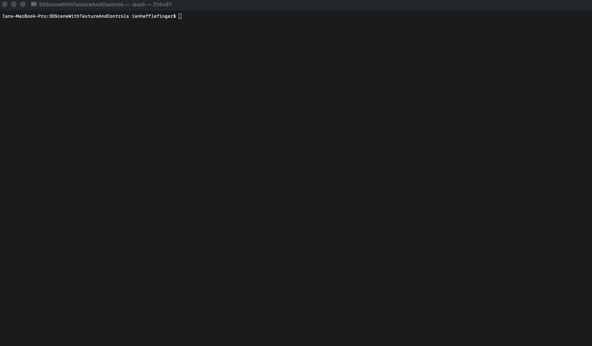

# 3D Scene with Textures, Lighting, and Camera Controls

An interactive 3D scene built from scratch in C++ with modern OpenGL (core profile) and GLSL shaders. Textured objects sit on a table and are lit by a light source, and you explore the scene with a free-fly camera driven by the keyboard and mouse.



## Features

- Modern OpenGL (shader-based pipeline, vertex array/buffer objects)
- Texture-mapped objects loaded from PNG files
- Lighting with a visible light source
- Free-look camera with keyboard movement and mouse look
- Cross-platform: builds on macOS and Windows with CMake

## Controls

| Input | Action |
| --- | --- |
| **W** | Zoom in |
| **S** | Zoom out |
| **A** | Move left |
| **D** | Move right |
| **Q** | Move up |
| **E** | Move down |
| **Mouse** | Look around |

## Quick start

Clone the repo and move into the project folder, since the build scripts live there:

```bash
git clone https://github.com/IanHefflefinger/CS-330.git
cd CS-330/3DSceneWithTextureAndControlsThreeCompleteObjectsAndLight/3DSceneWithTextureAndControls
```

### macOS

Requires [Homebrew](https://brew.sh) and the Xcode command line tools (`xcode-select --install`).

```bash
./build-mac.sh --run
```

The script installs CMake, GLFW, GLEW, and GLM through Homebrew, builds the project, and launches it. Drop `--run` to build without launching.

### Windows

Requires [Git](https://git-scm.com), [CMake](https://cmake.org/download/), and Visual Studio (or Build Tools) with the **Desktop development with C++** workload.

```powershell
powershell -ExecutionPolicy Bypass -File .\build-windows.ps1 --run
```

The script sets up [vcpkg](https://github.com/microsoft/vcpkg) (cloned to `%USERPROFILE%\vcpkg`), installs GLFW, GLEW, and GLM, builds a Release binary, and launches it. The first run takes a few minutes while the libraries compile.

## Building manually

If you already have GLFW, GLEW, and GLM installed, run this from the project folder:

```bash
cmake -S . -B build -DCMAKE_BUILD_TYPE=Release
cmake --build build --config Release
./scene          # scene.exe on Windows
```

On macOS with Homebrew, add `-DCMAKE_PREFIX_PATH="$(brew --prefix)"` to the first command. On Windows with vcpkg, add `-DCMAKE_TOOLCHAIN_FILE=<vcpkg>/scripts/buildsystems/vcpkg.cmake`.

## Repository layout

```
CS-330/
├── README.md
├── navigating_around_scene.gif
└── 3DSceneWithTextureAndControlsThreeCompleteObjectsAndLight/
    ├── resources/
    │   └── textures/                  # PNG textures loaded at runtime
    └── 3DSceneWithTextureAndControls/
        ├── Source.cpp                 # scene setup, shaders, render loop, input
        ├── camera.h                   # camera class
        ├── stb_image.h                # image loading (single-header library)
        ├── CMakeLists.txt
        ├── build-mac.sh
        └── build-windows.ps1
```

Run the program **from the `3DSceneWithTextureAndControls` folder**: textures are loaded using the relative path `../resources/textures/`, so launching from anywhere else will give a black or untextured scene.

Texture files expected in `resources/textures/`: `woodTableTexture.png`, `blueTexture1.png`, `watchStrapTexture.png`, `watchBodyTexture.png`, `watchFaceTexture.png`, `appleTexture.png`.

## Troubleshooting

- **Black or untextured scene:** run from the project folder and confirm the texture files above exist.
- **Window won't open on macOS:** macOS supports OpenGL up to 4.1, so the project requests a 4.1 core context with `#version 410 core` shaders.
- **CMake can't find GLFW/GLEW/GLM:** re-run the platform build script, or point `CMAKE_PREFIX_PATH` / the vcpkg toolchain at your install.

## Built with

C++17, OpenGL 4.1 core, [GLFW](https://www.glfw.org), [GLEW](https://glew.sourceforge.net), [GLM](https://github.com/g-truc/glm), [stb_image](https://github.com/nothings/stb)
